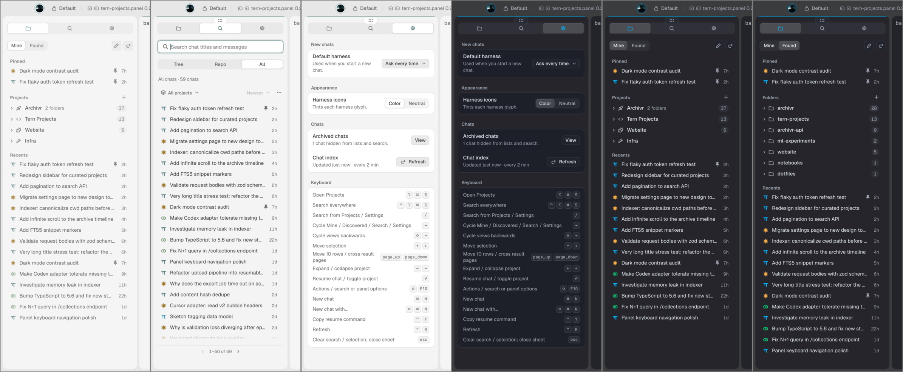
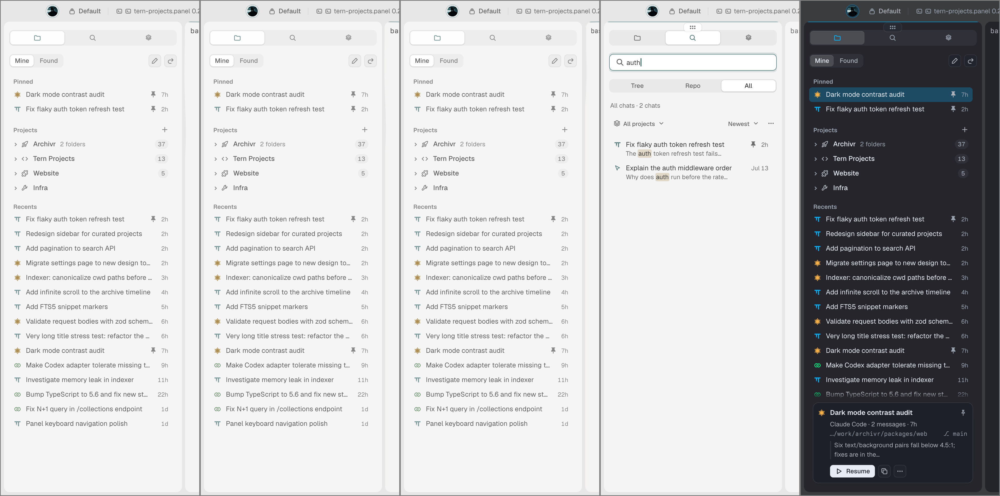

# tern-projects

A curated project sidebar and unified agent history search for [Tern](https://stencil.so/tern).

Bring order to your AI coding sessions across **OMP, Claude Code, Codex, Pi, OpenCode, and Cursor**.



---

## Quickstart

Run this inside Tern:

```sh
tern plugin install github.com/thegeneralist01/tern-projects
```

**Toggle the sidebar:**
- **macOS:** `⌘ ⌥ S`
- **Windows / Linux:** `Ctrl + Alt + S`

*(Or open **Projects** from the Tern command palette).*

That's it. Tern fetches the plugin, and the background engine builds automatically on first load. No manual compile steps, no extra configuration.

To update later:
```sh
tern plugin install github.com/thegeneralist01/tern-projects --force
```

---

## What it does

If you use multiple AI coding agents, your sessions are scattered across hidden SQLite databases and JSONL files. `tern-projects` unifies them into a fast, native sidebar:

- 📁 **Curated "My Projects" & Multi-Folder Workspaces** — Real projects rarely live in a single directory. Group an app, its backend API, shared libraries, and documentation into one named project with a custom icon.
- 🎯 **Primary Launch Directories** — Pick one folder as **Primary** (where fresh agent sessions spawn), while additional directories are automatically supplied via `--add-dir` to harnesses that support multi-folder workspaces (OMP, Claude Code, Codex).
- 🔍 **Instant Full-Text Search** — FTS5-powered search across all your past sessions. Filter by **Worktree**, **Repository**, or **All history** with live keyword highlighting.
- 🚀 **Fresh Chat Launching** — Press `⌘N` (`Ctrl+N`) to launch a new chat in your preferred CLI (`omp`, `claude`, `codex`, `pi`, `opencode`, or `cursor`).
- 📌 **Global Pins & Recents** — Keep critical threads pinned to the top of your sidebar. Recents keeps your 15 most recent chats one click away.
- 🗄️ **Local Archiving & Safe Deletion** — Archive threads to hide them without losing data, or permanently delete sessions via verified native CLI calls.



---

## Keyboard-First Controls

Optimized for speed and one-handed navigation:

| Action | macOS | Windows / Linux |
|---|---|---|
| **Toggle Projects sidebar** | `⌘ ⌥ S` | `Ctrl + Alt + S` |
| **Search everywhere** | `⌃ ⌥ ⌘ S` | `Ctrl + Alt + Shift + S` |
| **Cycle views** (Projects ➔ Found ➔ Search ➔ Settings) | `Tab` / `Shift + Tab` | `Tab` / `Shift + Tab` |
| **Quick Search** from Projects or Settings | `/` | `/` |
| **New chat** (in current project/folder) | `⌘ N` | `Ctrl + N` |
| **New chat with…** (choose harness) | `⇧ ⌘ N` | `Shift + Ctrl + N` |
| **Resume chat** | `Enter` | `Enter` |
| **Fold / unfold project** | `←` / `→` | `←` / `→` |
| **Context menu / Actions** | `Shift + F10` | `Shift + F10` |
| **Copy resume command** | `⌃ Y` | `Ctrl + Y` |
| **Dismiss / Clear search / Close modal** | `Esc` | `Esc` |

Inside any text field, standard terminal editing shortcuts just work (`⌘A`/`Ctrl+A` select all, `⌘⌫`/`Ctrl+U` delete line prefix, `⌥⌫`/`Ctrl+⌫` delete word).

---

## Supported Coding Harnesses

| Agent | Fresh Launch Command | Native Resume | Multi-Folder Support | Deletion Support |
|---|---|---|---|---|
| **OMP** | `omp --cwd <primary> [--add-dir <extra>...]` | `omp --resume <path>` | ✅ Multiple `--add-dir` | Transcript + artifact unlinking |
| **Claude Code** | `claude [--add-dir <extra>...]` | `claude --resume <id>` | ✅ Multiple `--add-dir` | Exact session history filtering |
| **Codex** | `codex --cd <primary> [--add-dir <extra>...]` | `codex resume <id>` | ✅ Multiple `--add-dir` | `codex delete <uuid> --force` |
| **Pi** | `pi` | `pi --session <path>` | Single root | Exact file unlinking |
| **OpenCode** | `opencode <primary>` | `opencode --session <id>` | Single root | `opencode session delete <id>` |
| **Cursor** | `cursor-agent` / native CLI | Resumes in directory | Directory | Clean database record pruning |

---

## How It Works

- **Non-destructive**: Your original git worktrees, folders, and transcripts are never touched or rearranged.
- **Fast SQLite FTS**: Full-text indexing runs in a separate local SQLite database (`index.sqlite`), refreshing in the background every two minutes.
- **Durable Library**: Your custom projects, icons, pins, and preferences are stored in an independent `library.sqlite` so reindexing the cache never wipes your setup.

---

## Contributing

Contributions are welcome! Whether you are fixing a bug, improving Luau block performance, or adding support for a new AI coding assistant, see [CONTRIBUTING.md](CONTRIBUTING.md) for architecture notes and step-by-step instructions.

---

## Changelog

See [CHANGELOG.md](CHANGELOG.md) for release notes.

---

## License

[MIT](LICENSE) © 2026 thegeneralist01
